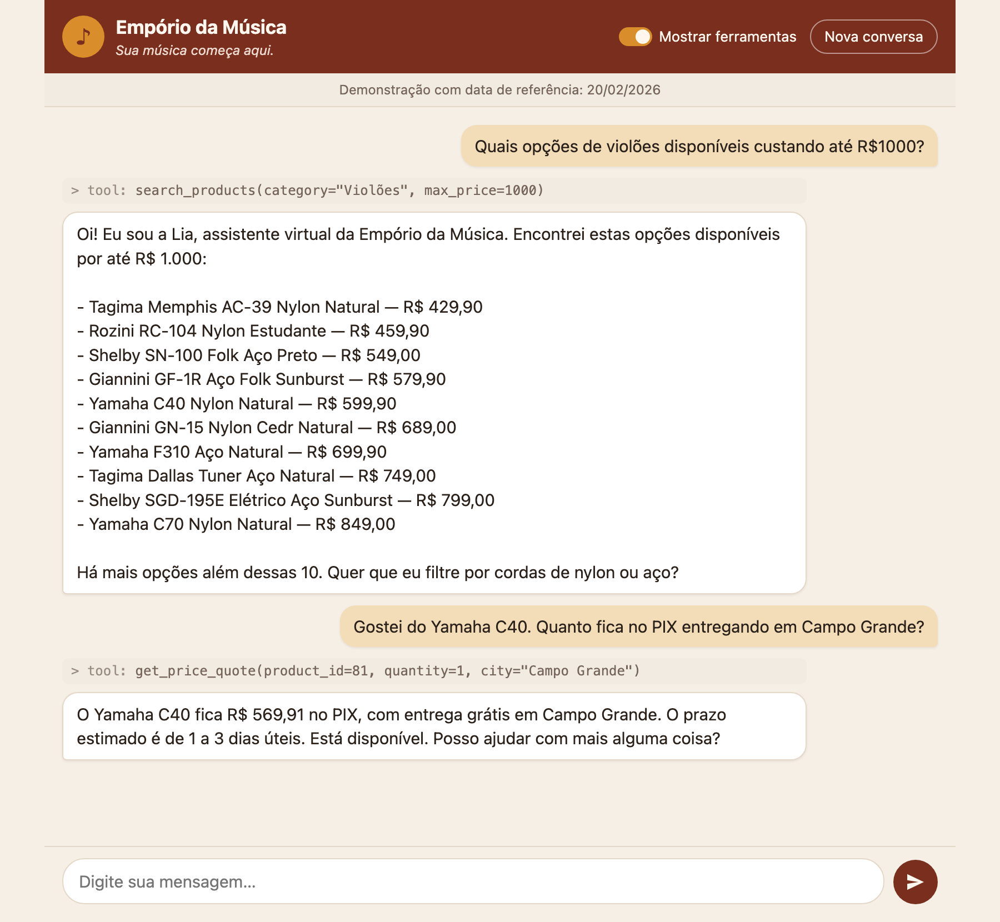

# Empório da Música — Customer Service Agent

> *"Sua música começa aqui."*

## 1. Overview

Prototype of a text-message customer service agent for **Empório da Música**, a fictional musical instrument store in Campo Grande/MS. The agent, **Lia**, resolves recurring questions on its own (opening hours, order status, product price and availability) by querying store data and applying the store policies, and hands off to the team only for exceptions such as complaints, returns or cases the policy does not cover.

Built for the Artefact AI Engineer technical challenge.



## 2. How to run

Requirements: Python 3.11 or newer and an OpenAI API key. No Docker, database or Node.js: the store data are CSV files in the repository, and the chat page is served by Python itself.

macOS / Linux:

```bash
python3 -m venv .venv
source .venv/bin/activate
pip install -r requirements.txt
cp .env.example .env             # then fill in OPENAI_API_KEY
```

Windows (PowerShell or cmd), without activating the environment:

```bat
py -m venv .venv
.venv\Scripts\python -m pip install -r requirements.txt
copy .env.example .env
```

Then fill in `OPENAI_API_KEY` in `.env`. On Windows, use `.venv\Scripts\python` wherever the commands below say `python`.

Checked from a fresh clone on macOS with Python 3.11 (all tests pass, the chat answers). Linux and Windows use the same code and dependencies (`tzdata` provides the time zone data Windows lacks, and every file is read as UTF-8), but were not run on those systems.

Start the chat:

```bash
python -m emporio                # then open http://localhost:8000
```

Use `--port 8080` if port 8000 is taken. Turn on **Mostrar ferramentas** at the top of the page to see which tools the agent called for each answer. **Nova conversa** starts over with an empty history.

To try the order and return scenarios, which use orders from 2025-10 to 2026-03, fix the date in `.env`, for example `REFERENCE_DATE=2026-02-20`.

Run the tests:

```bash
python -m pytest
```

Regenerate the example conversations in `examples/` (calls the OpenAI API, a few cents):

```bash
python -m scripts.run_examples
```

Environment variables (`.env.example`):

| Variable | Default | Purpose |
|---|---|---|
| `OPENAI_API_KEY` | — | OpenAI key. The account needs paid credit: the free tier does not support GPT-6 models. |
| `OPENAI_MODEL` | `gpt-6-luna` | Model used by the agent. |
| `OPENAI_REASONING_EFFORT` | `low` | Reasoning effort per call. |
| `REFERENCE_DATE` | empty | Optional ISO date that fixes "today" (see [Assumptions](#4-assumptions)). |

## 3. Technical decisions

### Agent approach

Direct function calling with the official `openai` SDK, in one short module (`emporio/agent.py`). For each customer message the agent:

1. Appends the message to the conversation history.
2. Sends the system instruction, the whole history and the five tool schemas to the model.
3. If the model asks for tools, validates and runs them (`execute_tool`) and sends the results back with the same `call_id`.
4. Repeats step 3 until the model writes a text answer.

Safeguards:

- **Tool-call limit.** At most 5 tool calls per message. After that the request is sent with `tool_choice="none"`, so the model has to answer with what it already has. Five covers search + quote + ticket, and stops a model calling tools in circles.
- **API errors never reach the customer as a crash.** Connection errors, timeouts (30 s, with the SDK's 2 automatic retries), rate limits and invalid keys become a short apology in Portuguese. The failed message is removed from the history, so no `function_call` is left without its output and the customer can simply try again. The log records only the error type and code: the SDK message for an invalid key contains part of the key.

*Alternative discarded:* LangChain or LangGraph. For one agent with five tools they add dependencies and hide the loop, which is the part worth showing.

### Model and provider

**OpenAI `gpt-6-luna`, reasoning effort `low`.**

The design decides how much model is needed. Search, prices, installments, shipping and deadlines are computed in code, and the policies are in the prompt. What is left for the model is to understand the customer, pick the right tool, fill its arguments and write a friendly answer in Portuguese. That is a focused, high-volume task, which is what Luna is for:

- **Cost.** Luna is the cheapest model of the GPT-6 line (US$ 0.10 per million input tokens, US$ 0.50 per million output tokens). Measured on the real agent, one model call uses about 5,700 input tokens (mostly the policies) and under 50 output tokens. That is about US$ 0.0006 per call, roughly US$ 1 per thousand customer messages, before the prompt-cache discount: from the second call of a conversation on, almost the whole prompt is served from cache.
- **Speed.** A customer message takes 2 to 4 seconds end to end, including tool calls. For a chat, latency matters more than extra reasoning.
- **Reasoning effort `low`** (the Luna default is `medium`). The hard thinking was moved into code, so the model does not need long reasoning to choose between five tools. `low` answered every scenario correctly and keeps answers fast.
- **Plan B: `gpt-6.1-terra`**, a larger model, if Luna had failed on policies or tone. It was not needed: every problem found while testing (Markdown formatting, a search with too many words, a ticket opened before the customer confirmed) was fixed in the prompt or in a tool, not by a bigger model. Model and effort are read from `.env`, so trying Terra is a one-line change.

**Why OpenAI.** Strict function calling (the API guarantees the arguments match the schema), the Responses API for reasoning models with tools, and an official Python SDK. Anyone with an API key can run the project, with no GPU or model download.

*Alternatives discarded:*
- **A larger model for everything** (Terra or Sol): more cost and latency for capacity the design does not use.
- **A local model** (e.g. via Ollama): free per message, but small local models are usually less reliable at tool calling, and the evaluator would need to download several gigabytes and have suitable hardware.

### API

Responses API, not Chat Completions: on GPT-6 Luna, Chat Completions only accepts tools with reasoning disabled.

- **Tool schemas.** They are generated from the Pydantic argument models with `openai.pydantic_function_tool()`, which produces a valid strict-mode schema: every field required, optional fields nullable, no extra properties. That helper returns the Chat Completions envelope (`{"type": "function", "function": {...}}`), so `build_tool_schemas()` moves the fields to the flat format the Responses API expects.
- **Explicit history.** The history is a plain list of input items built by our code and sent in full on every call, instead of chaining calls with `previous_response_id`. Every item of `response.output`, reasoning items included, is appended before the tool results, as reasoning models require.
- **Nothing stored at OpenAI.** Requests use `store=False` with `include=["reasoning.encrypted_content"]`, so reasoning items can be sent back without OpenAI keeping customer conversations (policy 9).

### Retrieval: policies in context, data behind tools

The whole policy manual (about 1,700 words) goes in the system instruction, between `<policies>` tags. There is no RAG.

The challenge asks the agent to know *when to query data and when to query policies*. The split follows how each kind of information behaves:

- **Policies** are short and stable, so they are always at hand, and the model decides when to apply them: hours, payment rules, return conditions.
- **Data** changes (stock, prices, order status), so it stays behind tools, and the model must call a tool to see it.

*Alternative discarded:* RAG over the manual. For a document this short it adds an embedding step, a vector store and the risk of retrieving the wrong section. It becomes the right choice if the manual grows.

**Product search** is keyword search over the product name, brand, category and description, ignoring accents and case. Every word of the query must match. The model does the "semantic" part: it turns the customer's sentence into a few search words and, if a search returns nothing, tries again with fewer words. "Violão bom para iniciante" becomes `query="iniciante", category="Violões"` and finds the models whose description says "iniciantes".

*Alternative discarded:* embeddings (semantic search). With a catalog this small, keyword search finds every product, and the results are exact and easy to test. Embeddings would add an API call or a local model, a vector store to rebuild when the catalog changes, and "similar" matches that can mix up close models such as the D-28 and the D-28E, which is risky when the answer is a price. The next step for a larger catalog would be hybrid search: keywords plus embeddings.

### Prompt strategy

- **Three Markdown files** in `prompts/`, outside the Python code:
  - `persona.md`: identity, introduction, tone, scope, contact details, how to buy, and the critical rules on prices and safety.
  - `workflow.md`: the five service stages of policy 7.2, when to use each tool, how to read tool results, the special situations of 7.3, out-of-hours behavior, and when to hand off to the team.
  - `policies.md`: the PDF converted to Markdown once, with tables turned into lists. The PDF remains the official source.
- **One instruction per request.** `build_system_prompt()` joins the three files under titled sections into a single `instructions` parameter, and adds the current day of the week, date, time and whether the store is open, in Campo Grande time.
  - It is rebuilt on every message, so a long conversation never works with a stale clock.
  - The fixed parts come first and the time last, so the long unchanging prefix can benefit from the API's prompt caching.
- **A named persona: Lia.** She introduces herself once, in her first reply, as the store's virtual assistant, and answers the question in that same message. The name gives the store a voice, and the introduction tells the customer they are talking to an AI: policy 7 says WhatsApp service can be done by people or by the virtual assistant. If asked whether she is human, she says she is not and offers the team.
- **Written in my own prompt format, in Portuguese.** The prompt files follow the structure I use in my customer-service agents: blocks with uppercase titles, short bullet rules, quoted example phrases, critical restrictions marked with ⚠️, and each service step written as a stage (`Estágio`, `Nome`, `Objetivo`, `Instrução`, `Avance somente quando`). Rules in short bullets are easier to review and change than paragraphs, and the language matches the policies and the customer. The agent always answers in Brazilian Portuguese. Tool and field names stay in English, as in the code.
- **The five stages are a guide, not a script.** A customer who opens with a direct question gets a direct answer, without a forced greeting.

### Interface

A chat page in the browser, served locally by `python -m emporio` (`emporio/web.py` and `emporio/static/`).

- **Standard library only.** The server is Python's `http.server`, and the page is plain HTML, CSS and JavaScript: no framework, no `npm install`, no extra Python dependency. The page sends each message to `POST /api/message` and shows the answer.
- **"Mostrar ferramentas" replaces a `--debug` flag.** It shows the tool calls of each answer, e.g. `> tool: get_price_quote(product_id=81, quantity=1, city="Campo Grande")`, which is the evidence that the agent knows when to query data.
- **Safe by default.**
  - The server listens only on `127.0.0.1`.
  - Answers are inserted with `textContent`, never as HTML.
  - Messages are limited to 2,000 characters.
  - Only the three page files can be served.
- **The agent does not change.** The page is a thin layer over `Agent.reply()`, so a WhatsApp integration would replace only this layer.

*Alternatives discarded:*
- **Terminal chat**, the original plan. It is simpler, but harder to demo and read: long product lists and tool calls are clearer in chat bubbles.
- **Streamlit or Gradio.** They are quick to build, but add a heavy dependency and control the layout.

### Conversation history

In memory, as the list of input items in `Agent.history`. Each browser tab has its own conversation id and its own `Agent`. The server keeps up to 200 conversations and drops the oldest beyond that, so memory stays bounded. Within it the agent remembers everything, including tool results. For example, a customer who already verified an order is not asked for the e-mail again. Nothing is kept after the server stops; see [limitations](#7-known-limitations-and-next-steps).

### Agent tools

The agent has five tools, implemented in `emporio/tools.py`:

| Tool | What it does |
|---|---|
| `search_products` | Searches by text (name, brand, category and description), category, brand or maximum price, ignoring accents and case ("violao" finds "Violão"). Returns up to 10 products, available ones first, with list price, active promotion, stock and availability (`available`, `out_of_stock`, `discontinued`, `coming_soon`). |
| `get_order_status` | Requires order number **and** purchase e-mail. Returns status, dates, items, tracking code and, for delivered orders, the return and exchange deadlines already computed. |
| `list_active_promotions` | Lists active promotions with original price, promotional price and discount (policy 6.2). |
| `get_price_quote` | For a `product_id` and quantity: PIX, debit and boleto totals, valid credit card installments, whether payment methods can be combined, and shipping for the given city. |
| `create_support_ticket` | Records a complaint, return/exchange request, data deletion request or uncovered policy question in `tickets/tickets.jsonl` (outside Git) and returns a protocol number and response deadline. |

Decisions:

- **Business rules live in code, not in the model.** PIX discount, installment tiers, shipping, promotion prices, return windows and business-hour deadlines are pure functions in `emporio/rules.py`, each citing its policy item. The model only picks a tool and fills its arguments. *Alternative discarded:* letting the model apply the policy text to compute prices, which is cheaper to build but can produce wrong numbers with full confidence.
- **Tools receive identifiers, never business values.** `get_price_quote` takes a `product_id`, not a price, and reads price and promotion from the data. A price typed or hallucinated by the model can never enter a calculation.
- **Pydantic validation, errors returned to the model.** Each tool has an argument model with `extra="forbid"` and value constraints (e.g. quantity from 1 to 20). `execute_tool` returns validation errors as the tool result, so the model can correct its call instead of the program crashing.
- **Privacy by design (policy 9).** A wrong e-mail gets exactly the same answer as a non-existent order, so the tool never confirms that an order exists. Results never include phone, e-mail, address or customer id.
- **Deterministic time.** Tools receive "now" from the code (`ToolContext.now`, in `America/Campo_Grande`), never from the model, which makes tests reproducible. Opening hours skip Sundays and national and Mato Grosso do Sul holidays (`holidays` library).
- **Category as an enum.** `search_products` accepts only the nine category names from `categories.csv` (a test keeps them in sync), so the model cannot filter by a misspelled category.

### Data handling

- **pandas, loaded once at startup.** The dataset is small (under 200 rows), so an in-memory DataFrame is enough and keeps the project easy to run. In production the natural step is SQLite or Postgres, because stock changes in real time.
- **Fail fast on structural problems, clean and log content problems.** Missing columns, duplicated ids, unknown statuses, broken references between tables and unparseable dates raise `DataValidationError` at startup, so the agent never answers from data it cannot trust. Problems with a safe fix (a malformed tracking code) are cleaned and logged. *Alternative discarded:* silently dropping bad rows, which would hide data errors from the team.
- **Data minimization.** The customer phone number is not loaded at all, since no answer needs it (LGPD, policy 9).
- **Money stored as `float`, rounded with `Decimal`.** Values are kept as `float` in the DataFrames, but every rounding to cents goes through `rules.round_money`, which uses `Decimal` with half-up rounding. Plain `round()` on floats can round a half cent down (`round(2.675, 2) == 2.67`), and R$ 151,905 must show as R$ 151,91. *Alternative discarded:* `Decimal` columns everywhere, which adds conversion noise with no practical gain at this scale.

File renames: the original CSVs were named `desafio_tecnico_ai_eng - <table>.csv`. They were renamed to `categories.csv`, `customers.csv`, `order_items.csv`, `orders.csv`, `products.csv` and `promotions.csv` to avoid spaces in paths. Content was not changed. The policy manual keeps its original name, `data/políticas_da_loja.pdf`.

#### Data issues found and how they are handled

| # | Issue | Handling |
|---|---|---|
| 1 | No brand column; the brand only appears in the product name. | `brand` is extracted from the name with a fixed list of known brands (word boundaries, so "Kala" does not match "Kalani"). |
| 2 | Products 135–144: the name says one brand and the description another (e.g. "Music Man Bass 1X" described as a Fender Jazz Bass; "Korg Synth 1" described as an 88-key Roland while specs say 61 keys). | The **name** is treated as the source of truth. Descriptions are kept as they are; the conflict is a known limitation. |
| 3 | `specs` is JSON with inconsistent spacing and different keys per category. | Parsed into a `dict`. |
| 4 | Categories 6, 7 and 8 (woodwinds, brass, orchestral strings) have no products, although the policy says the store sells them. | Kept. The agent must not promise these items, since none are in the catalog. |
| 5 | Empty `tracking_code`, `estimated_delivery` and `notes` in 12 orders. | Expected: only `shipped` and `delivered` orders have tracking. Loaded as missing values, not errors. |
| 6 | Tracking codes must follow policy 5.3 (`BR` + 9 alphanumeric + `BR`). | Validated with a regex. All 8 codes in the data are valid. A malformed code would be discarded with a warning, because showing an invalid code is worse than saying it is unavailable. |
| 7 | Order totals that do not match current prices: order 3 (R$ 3,450 vs 2 × R$ 1,749 = R$ 3,498) and order 20 (R$ 1,400 vs R$ 1,488). | `total_brl` is kept as recorded: it is what the customer paid. Order totals are never recalculated from current prices. |
| 8 | Product 130 is `coming_soon` but appears in a delivered order (3) and a pending one (14). | Kept and documented. |
| 9 | Historical orders whose installments break the current rule 3.1 (orders 9, 16 and 18). | Kept as records of what happened. The rule is applied only to new quotes. |
| 10 | Products 93, 96 and 99 have two promotions each (all inactive). Promotions have no dates, only `is_active`. | `is_active` is converted to boolean. A check guarantees at most one active promotion per product, since promotions do not stack (policy 6.2). |
| 11 | Same e-mail for two customers (`bruno.martins@jmail.com`, ids 11 and 43) and several similar names. | Kept. Order verification uses order number + the e-mail of that order's customer, so it is still unambiguous. Customers are never identified by name. |
| 12 | E-mail case and spaces. | Normalized to lowercase without surrounding spaces. |
| 13 | Rows in `products.csv` are not sorted (product 145 appears before 131). | Sorted by `product_id`. |

Checked with no problems found: duplicated ids, references between tables (orders → customers, items → orders/products, promotions → products), date format, negative prices or stock, malformed e-mails.

## 4. Assumptions

- **Delivery date.** There is no actual delivery date in the data. For `delivered` orders, `estimated_delivery` is taken as the date the customer received the order.
- **Purchase channel.** There is no channel column. All orders in `orders.csv` are assumed to be online purchases, since they have delivery dates and tracking codes.
- **Active promotion.** Promotions have no start or end date, so "active" means `is_active = 1`.
- **Fictional e-mail domains.** Customer e-mails use made-up domains (`jmail.com`, `coldmail.com`, `inlook.com`, `hayoo.com.br`). They are kept exactly as provided, since order verification compares the e-mail the customer types with the stored one.
- **Preference exchange period.** Policy 4.3 says "up to 7 days" without saying from when. It is counted from delivery, like the withdrawal right (4.1), which is the customer-friendly reading.
- **Installment minimums.** The table in section 3 says "minimum installment R$ 100", while 3.1 sets tiers (2x–3x: R$ 50; 4x–6x: R$ 80; 7x–12x: R$ 100). The more specific rule, 3.1, is applied. 1x is always allowed.
- **Free local shipping at exactly R$ 500.** Policy 5.1 covers "above" and "below" R$ 500 but not exactly R$ 500; it is treated as free shipping.
- **Metropolitan region.** Policy 5.1 applies to the metropolitan region of Campo Grande, but the data does not list its cities. Only Campo Grande gets the local rule; any other city gets the carrier options of 5.2.
- **Large instruments.** Categories "Baterias e Percussão", "Teclados e Pianos" and "Cordas Orquestrais" are flagged as possibly needing a special shipping quote (policy 5.2 mentions acoustic drums, digital pianos and double basses).
- **Price filter.** `max_price` compares against the current price (promotional price when there is an active promotion), since that is what the customer pays.
- **Shipping in totals.** Quote totals include the shipping fee only when it is known (Campo Grande). PIX applies to the products only; the fee is added after the discount.
- **Ticket deadline.** Policy 7.3 sets 24 business hours for complaints. The same deadline is used for every ticket type, since the policy gives no other.
- **Reference date.** Orders go from 2025-10-15 to 2026-03-22. Deadlines such as the 7-day return window only make sense close to that period, so `REFERENCE_DATE` can fix "today" for demonstrations. It replaces only the day: the time of day stays real, so "is the store open now?" still behaves naturally.
- **Store phone numbers.** Policy 1.2 lists (67) 3341-4444 as "Telefone / WhatsApp", while section 7 gives (67) 3321-4500 as the WhatsApp channel. The agent gives 3341-4444 as the phone and 3321-4500 as WhatsApp, since section 7 is the one specific to that channel.
- **Store e-mail.** Policy 1.2 spells it `contato@empóriodamusica.com.br` (with an accent), the cover `contato@emporiodamusica.com.br`. The cover version is used: an accent in an e-mail domain is most likely a typo. `prompts/policies.md` keeps the text exactly as in the PDF, and the correct contact details are listed in `prompts/persona.md`.
- **Partner stores.** Policy 7.1 asks to suggest partner stores "when possible", but no partner is listed anywhere, so the agent never names one.

## 5. Testing

`python -m pytest` runs 161 deterministic tests, no API key needed:

- **Data loader** (`tests/test_data_loader.py`): real data loads with the expected types, every product has a brand and category, the phone is not loaded, tracking codes follow policy 5.3, and broken files (missing file, duplicated id, unknown status, broken reference, two active promotions, bad date) are rejected.
- **Business rules** (`tests/test_rules.py`): PIX and promotional prices with half-up rounding, every installment tier boundary, combined payment above R$ 2,000, local shipping fee, return windows on the last valid day and the day after, opening hours including Sundays and holidays, and 24 business-hour deadlines across weekends.
- **Tools** (`tests/test_tools.py`): each tool against the real data, including the challenge scenarios (guitars up to R$ 1,000, Takamine GD20, return of a delivered order), privacy (wrong e-mail looks exactly like a missing order), invalid arguments returned as errors, and JSON-serializable results.
- **Agent loop** (`tests/test_agent.py`): uses a fake OpenAI client with scripted responses, so it costs nothing and always behaves the same. It covers:
  - a tool result sent back with the same `call_id`;
  - reasoning items sent back before tool results;
  - history kept between messages;
  - invalid arguments returned to the model;
  - `tool_choice="none"` after the 5-call limit;
  - a friendly message for each kind of API error;
  - the history rolled back after a failure;
  - the API key never written to the log;
  - flat strict schemas for the five tools.
- **Prompt and settings** (`tests/test_prompt.py`, `tests/test_config.py`):
  - section order, and policies inside a single pair of `<policies>` tags;
  - open/closed status and when the team is back, converted to Campo Grande time;
  - key facts from the PDF present in `policies.md`;
  - `.env` parsing, the reference date, and the key hidden from `repr`.
- **Chat page** (`tests/test_web.py`): uses a fake agent. It covers:
  - the answer and the formatted tool calls returned to the page;
  - history kept within a conversation, and two conversations kept apart;
  - empty, oversized or malformed messages rejected with HTTP 400;
  - the oldest conversation dropped beyond the limit;
  - the page served from a real server on a free port;
  - unknown paths answered with 404;
  - the server listening only on `127.0.0.1`.

The model's own behavior (choosing tools, applying policies, tone) is shown in the [example conversations](#6-example-conversations), generated by running the real agent.

## 6. Example conversations

Five conversations in [`examples/`](examples/), in Portuguese, each with the tools called before every answer (`> tool: ...`):

| File | Scenario | What it shows |
|---|---|---|
| [`01-violoes-ate-1000.md`](examples/01-violoes-ate-1000.md) | Guitars up to R$ 1,000 | Catalog search with a price filter, then PIX price, installments and shipping for one model. |
| [`02-takamine-gd20.md`](examples/02-takamine-gd20.md) | Takamine GD20 price | Price, stock and installments of a specific product. |
| [`03-devolucao-arrependimento.md`](examples/03-devolucao-arrependimento.md) | Regretted purchase | **The non-trivial case.** The agent asks for the order number and e-mail, checks the order, applies the 7-day return window (delivered on 17/02, open until 24/02), asks whether the customer wants to go ahead, and only then opens a ticket for the team. |
| [`04-endereco-e-horario.md`](examples/04-endereco-e-horario.md) | Address and hours | Answered from the policies, with no tool call. |
| [`05-fora-do-escopo.md`](examples/05-fora-do-escopo.md) | Out of scope | Strings (accessories are not sold) and an unrelated question, both declined politely. |

How they were made:

- **Real runs, not written by hand.** `scripts/run_examples.py` sends the scripted customer messages to the real agent (`gpt-6-luna`) and saves the transcripts. Answers were never edited. When one came out wrong, the prompt was fixed and all five were generated again.
- **Fixed date and time:** Friday, 20/02/2026, 10:00 in Campo Grande, so the opening hours and the return window give the same result on every run. The model's wording can still change between runs; the facts come from the tools.
- **No side effects:** the return ticket is written to a temporary folder, not to `tickets/`.

What the review caught, each fixed in `workflow.md` and followed by a new run of all five:

- **Ticket before consent.** The agent opened the return ticket as soon as the customer asked *"posso devolver?"*, before they said they wanted to. It now asks first, and a question is not a yes.
- **Missing closing step.** Policy 7.2 ends with "confirm whether the customer needs anything else". The agent rarely did it. After the first fix it overdid it, asking in every message, so the rule now says: once a request is solved, at most once in a row, and not when the message already ends with another question.

The screenshot at the top was taken from the chat page with the same reference date.

## 7. Known limitations and next steps

**Evaluation**

- **No automated evaluation of the model's answers.** The tests cover the code; the model's behavior was checked by hand on the example conversations. Next step: a set of scripted scenarios with expected tool calls and facts, scored automatically on every prompt change, with an LLM as judge for tone and policy compliance.

**Agent**

- **Model routing.** One model answers every message. At larger volume, a cheap router could send simple questions (opening hours) to Luna and complex ones (returns, complaints) to a larger model such as Terra or Sol. At this scale a single model is simpler and more reliable.
- **RAG if the policy manual grows.** The whole manual fits in the prompt today (about 5,700 tokens per call, mostly cached). A much larger manual would call for retrieving only the relevant sections.
- **Text search matches words, not meaning.** A synonym that appears in no product text ("pra começar" instead of "iniciante") depends on the model choosing better search words. Next step: hybrid search with embeddings if the catalog grows.

**Production**

- **WhatsApp integration.** The chat page would be replaced by a webhook endpoint; `Agent.reply()` stays the same.
- **Conversation memory across sessions.** History lives in memory and ends when the server stops. In production it would be persisted per WhatsApp number, linked to a verified customer, with a retention period and deletion on request (LGPD, policy 9).
- **A real database instead of pandas.** Stock and order status change in real time; CSVs loaded at startup do not. SQLite or Postgres, with the same tool functions on top.
- **Tickets in a local file.** `tickets/tickets.jsonl` stands in for the team's help desk, which a real deployment would call through its API.

**Data and policies**

- Product descriptions 135–144 contradict the product names (see data issue 2).
- Shipping prices for cities outside Campo Grande need the carriers' APIs (CEP, weight and dimensions); the agent says shipping is calculated separately.
- Only Campo Grande gets the local shipping rule; the other cities of the metropolitan region are not listed in the data.
- Municipal holidays and extended hours on special dates are not modeled.

## 8. AI coding assistant usage

I used **Claude** (Anthropic) in two roles, and **OpenAI** only as the agent's model at runtime:

| Tool | Used for |
|---|---|
| Claude (chat) | Planning: turning the challenge into a project instruction file, before any code. |
| Claude Code | Execution: writing code, tests and documentation, stage by stage, under my review. |
| OpenAI API (`gpt-6-luna`) | The model inside the agent. Not used to write the project. |

**The principle: a tool, not a "build everything" button.** I did not attach the challenge and ask for a finished project. I made the decisions, the assistant did most of the typing, and nothing was committed that I had not reviewed and could explain. Small reviewed steps also catch mistakes early, while they are cheap to fix.

**1. Planning first.** I read the whole challenge, then wrote the project's instruction file (`CLAUDE.md`) together with Claude in a chat: I drafted, it suggested, and I accepted, changed or rejected each suggestion until the file said what I wanted. It records:
- the technical decisions with their reasons (model, API, no RAG, rules in code, privacy);
- the six stages and the workflow for each one;
- the rules: language, code style, security (never commit `.env` or print the key, no force-push), and that example conversations must come from real runs.

It is a working file, kept out of the repository; its decisions are the ones justified in [section 3](#3-technical-decisions).

**2. Six stages, each one approved.** Data → rules and tools → agent → interface → examples → README, one commit or more per stage (see the Git history). For every stage:
1. Claude Code presented a short plan in plain language, and I approved or changed it.
2. It implemented the stage and ran the tests.
3. I reviewed the code and tried the result myself.
4. It updated the README, and committed only after my explicit approval.

Before the agent stage, it checked the current OpenAI documentation, since `gpt-6-luna` and the Responses API are newer than the assistant's training data.

**3. Decisions and corrections that came from me during the work**, for example:
- Replacing the planned terminal chat with a local browser page, built the same way as a monitoring dashboard I had made before (Python standard library plus plain HTML).
- Asking how conversation history works, which led to the history section and the memory limitation.
- Testing the chat myself and finding that *"algum Lendário violão Martin"* returned nothing: search did not look at product descriptions. That became the `fix:` commit.
- Asking whether that meant embeddings, and deciding against them for now (see [Retrieval](#retrieval-policies-in-context-data-behind-tools)).
- Asking for a fresh-clone install test, so the instructions above work for someone who has never seen the project.

**4. Learning, not only delivering.** At the end of each stage I asked for a study write-up in Portuguese: what the stage does, the execution flow, each decision with its rejected alternative, and the questions an interviewer would ask. It is kept out of the repository, but it is why I can explain any part of this code.
